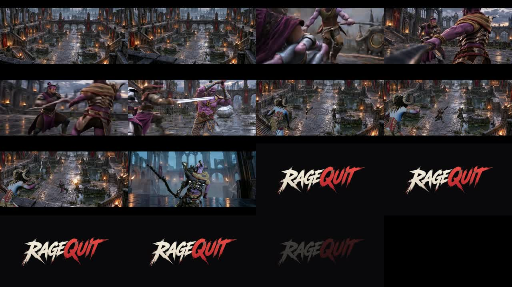

# RAGEQUIT · Intro cinematica

**[Guarda Crossfire](art/intro/RAGEQUIT-Crossfire.mp4)** · [Scarica il master MP4](https://raw.githubusercontent.com/Spidahh/ragequit-intro-cinematica/main/art/intro/RAGEQUIT-Crossfire.mp4)

RAGEQUIT è un’arena PvP con eroi, mira manuale, armi bianche, arco e magie. L’intro deve comunicare il movimento nello spazio dell’arena e far capire chi agisce, chi reagisce e dove finisce il colpo. L’autore ha chiesto un filmato animato con un combattimento rapido, il logo originale e la sola frase «Welcome to Rage Quit».

## Crossfire

La veduta d’apertura colloca lo scontro nella Drowned Cathedral. La camera entra fra Arbiter e Impaler e poi sale alle spalle di Pyromancer. Si vede la magia lasciare la sua mano, attraversare la piazza e colpire Impaler. Il taglio successivo raccoglie la reazione. Il logo entra a 5,15 secondi.

Il montaggio combina riprese di combattimento generate con AI e animazioni delle skin principali composte su una veduta in movimento. I suoni di passi, armi e magia e la voce sono del progetto. Il master dura 7,27 secondi in Full HD a 48 fps, con interpolazione dei fotogrammi e audio stereo. [Tempi esatti dei tagli e dati del file](crossfire/montaggio.json).

## Materiale per la revisione

[Studio e storia delle versioni](DOCUMENTAZIONE/STUDI/INTRO-DIREZIONI-21-10-2026.md). Il documento conserva i confronti con altri giochi, le tre proposte iniziali, i problemi rilevati, le prove locali e cloud e le decisioni di montaggio. Le osservazioni sulle offerte dei servizi si riferiscono alla data della prova. I percorsi di lavorazione citati nel testo storico si riferiscono all’ambiente originale.

I punti contestati dall’autore includono figure quasi ferme, arciere lento senza bersaglio visibile, posture deformate e duelli laterali che fanno pensare a un picchiaduro. Chi revisiona può controllare la leggibilità del tiro, la continuità delle armi e delle sagome fra i tagli e il raccordo fra piazza e balconata. La decodifica del master è verificata. La valutazione artistica spetta all’autore.

## Filmati e versioni conservate

- [ragequit-corale-v1](art/intro/alternative-20261021/corale/ragequit-corale-v1.mp4)
- [ragequit-corale-v2](art/intro/alternative-20261021/corale/v2/ragequit-corale-v2.mp4)
- [ragequit-illustrata-v1](art/intro/alternative-20261021/illustrata/ragequit-illustrata-v1.mp4)
- [ragequit-duello](art/intro/duello-azione-20261022/ragequit-duello.mp4)
- [ragequit-istante-prima-v1](art/intro/istante-prima-20261021/ragequit-istante-prima-v1.mp4)
- [ragequit-istante-prima-v2](art/intro/istante-prima-20261021/ragequit-istante-prima-v2.mp4)
- [RAGEQUIT-Arena](art/intro/RAGEQUIT-Arena.mp4)
- [RAGEQUIT-Clash](art/intro/RAGEQUIT-Clash.mp4)
- [RAGEQUIT-Crossfire](art/intro/RAGEQUIT-Crossfire.mp4)
- [RAGEQUIT-Drowned-Cathedral](art/intro/RAGEQUIT-Drowned-Cathedral.mp4)
- [RAGEQUIT-Ember](art/intro/RAGEQUIT-Ember.mp4)
- [ragequit-intro-cloud](art/intro/ragequit-intro-cloud.mp4)
- [ragequit-intro-hybrid](art/intro/ragequit-intro-hybrid.mp4)
- [ragequit-intro-v3](art/intro/ragequit-intro-v3.mp4)
- [RAGEQUIT-Riposte](art/intro/RAGEQUIT-Riposte.mp4)
- [RagequitIntro-Cinematic](art/intro/RagequitIntro-Cinematic.mp4)
- [video-1](art/intro/video-1.mp4)
- [video-2](art/intro/video-2.mp4)

## Attribuzioni

Alcune riprese di combattimento utilizzano il movimento di *Sintel* come riferimento, adattato al montaggio. Copyright Blender Foundation, www.sintel.org. [Fonte](https://durian.blender.org/sharing/) · [CC BY 3.0](https://creativecommons.org/licenses/by/3.0/). I modelli degli eroi derivano dai personaggi Paragon di Epic Games. I diritti dei materiali restano ai rispettivi titolari.
